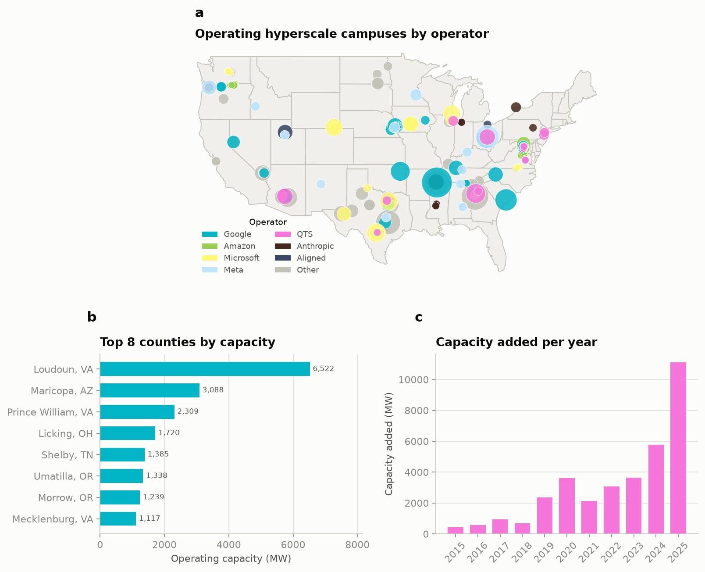

## Do hyperscale AI data centers raise US electricity prices, and who bears the environmental and health costs?

with Kevin Butler and Francesca Dominici.

Summary

Hyperscale data centers built to train and run AI systems are driving one of the fastest sustained increases in US electricity demand in decades, and recent causal estimates of their effect on electricity prices disagree, in part because they look at different geographic scopes and time horizons. Using a newly assembled utility&times;state&times;year panel (2021&ndash;2025) that links verified hyperscale campus locations and capacity to EIA-861 retail electricity sales, we implement a staggered-adoption event-study design (Callaway and Sant'Anna, 2021), a continuous capacity-intensity dose-response specification, a split by developer type (hyperscaler self-builds versus other developers), and a spatial-adjacency test of spillovers to neighboring utility territories. Industrial rates rise after a data center opens in every specification we run &mdash; by roughly \$13 to \$51 per megawatt-hour &mdash; though with only 12 treated utilities in our panel, this effect can't yet be called statistically reliable; we also flag a residential-rate result that fails a pre-trend check and so cannot be read as causal. Our clearest result, drawn from a much larger sample of 1,199 utilities, is that a utility's own residential price rises when its neighboring utilities host more data center capacity &mdash; evidence that costs are not necessarily contained within the county or utility that hosts a campus, and a pattern that lines up with an active complaint Maryland's utility regulator has filed with federal energy regulators alleging that grid-upgrade costs are being spread across an entire region rather than charged to the data centers driving them. A companion county-level analysis asks whether host communities see offsetting benefits in local jobs or income, and a utility-to-county crosswalk shows that the communities paying these costs and the communities capturing the benefits are frequently not the same ones. Beyond price, a parallel literature we engage with documents environmental and health concerns tied to facility siting &mdash; air pollution from fossil-fuel generation and backup diesel generators, water use for cooling, and noise &mdash; including evidence that how a campus sources its power materially shifts who bears the resulting air-quality burden, and a state-level accounting exercise projecting that air-pollution health costs from data-center growth could substantially exceed the corresponding electricity-price costs. We view this as a pilot study that establishes a reusable, public, replicable pipeline and an honest power analysis, not a resolution of the underlying question.

<a href="https://lisathalheimer.github.io/Thalheimer_Butler_Dominici_DataCenters_WorkingPaper_2026.pdf" target="_blank">Read the working paper (PDF)</a>.

This paper is one part of a broader research portfolio with the Dominici Lab at the Harvard T.H. Chan School of Public Health, anchored by a $562,500 Harvard Frontiers of Innovation for Societal Impact grant held with Drs. Francesca Dominici and Le Xie, building a three-part framework &mdash; a data pipeline tracking data centers' resource consumption and emissions, statistical models of how a facility's pollution is likely to harm the health of surrounding communities, and an interactive toolkit for communities, regulators, utilities, and developers to evaluate a proposed site before it is approved.

## Verifying hyperscale data centers' renewable-electricity claims, and where facilities should (and should not) be sited

with Tina Vartziotis (in revision, *Scientific Reports*).

Summary

Hyperscale data center operators increasingly make public claims about powering their facilities with renewable electricity, but these claims are difficult to verify independently at the level of the physical grid a facility actually draws from. We develop methods to check hyperscale operators' renewable-electricity claims against grid-level data, and to evaluate where new facilities should, and should not, be sited given the generation mix and capacity of the grid that would serve them.

## Decoding community benefits agreements at US data center hosts

with Brandon Karagozian (Harvard MPP) and Nicholas D'Acri (UC Berkeley).

Summary

Data center developers increasingly negotiate community benefits agreements with host communities, offering jobs, tax revenue, or local investment in exchange for siting approval. We are decoding these agreements across US data center hosts to assess whether they deliver verifiable local benefit or function mainly as a licensing tool, and whether their commitments can be paired with measurable, enforceable local outcomes rather than one-off negotiated promises.

## Event attribution for quantifying the role of climate change in internal displacement: The case of Somalia
with Jesus Crespo Cuaresma, Sihan Li, Raya Muttarak and Friederike Otto.

Summary

The science of event attribution is relatively nascent. While its body of knowledge is growing fast, numerous gaps remain, including on the appropriate statistical methods and the proper consideration of various degrees of vulnerabilities and exposure. We show that attributing climate change to internal displacement requires a focus on the interplay between climate and non-climate drivers of impacts via a feasibility study of the 2020 floods in Somalia. Using detailed internal displacement flow data, we describe the socio-spatial characteristics associated with the flooding event. We show that climate change has a limited role in revealing displacement impacts and magnitude following the extreme event.

I have presented this paper at the [2022 Wittgenstein Centre](https://www.oeaw.ac.at/vid/events/calendar/conferences/wic-2022-population-and-climate-change) and the [2021 EGU](https://ui.adsabs.harvard.edu/abs/2021EGUGA..2310845T/abstract) conferences.

## Facing involuntary immobility: Prioritizing the marginalized in climate and disaster risk policy

with Fabien Cottier, Andrew Kruczkiewicz, Carolynne Hultquist and Cascade Tuholske.

Summary

Globally, populations are increasingly located in areas at high risk of frequent, extreme weather events. Some exposed populations have the ability to move to safer places; others are unable to get out of harm’s way. The climate risks facing these involuntary immobile populations are not often addressed by local and national authorities, despite increasing recognition by international development agencies and humanitarian actors. Here we discuss when and how climate and extreme weather events lead to involuntary immobility by considering the influence of political, socioeconomic, and environmental factors. Addressing barriers in policy and disaster planning, early warning systems and anticipatory action could be tailored to support involuntarily immobile communities. While policy and planning should be data-informed, lack of appropriate data quality should not limit governments and institutions from taking action. Immobility needs to be aligned with the broader sustainable development objectives which entail climate justice and orderly migration.

This paper is an outcome of the World Cafe session at the 2023 [Columbia University Managed Retreat](https://adaptation.ei.columbia.edu/sites/default/files/content/agenda%20v6.19.23.pdf#page=4) conference and co-authored with session participants.