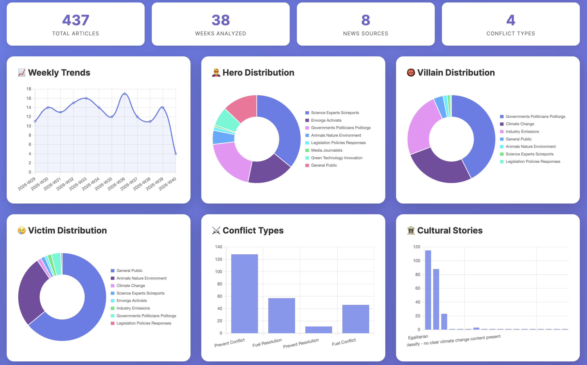

# Climate Narrative Analyzer

This dashboard collects climate news and uses AI to show how different outlets tell the story: who is presented as responsible, who is affected, and which wider themes appear. You can compare sources, explore changes over time, or paste in an article to analyse it.

An overview of trends and recurring narratives across climate news coverage.

[Try the Climate Narrative Analyzer](https://climate-narrative-analyzer.onrender.com/) · [View the source code](https://github.com/mattguida/climate-narrative-analyzer)
