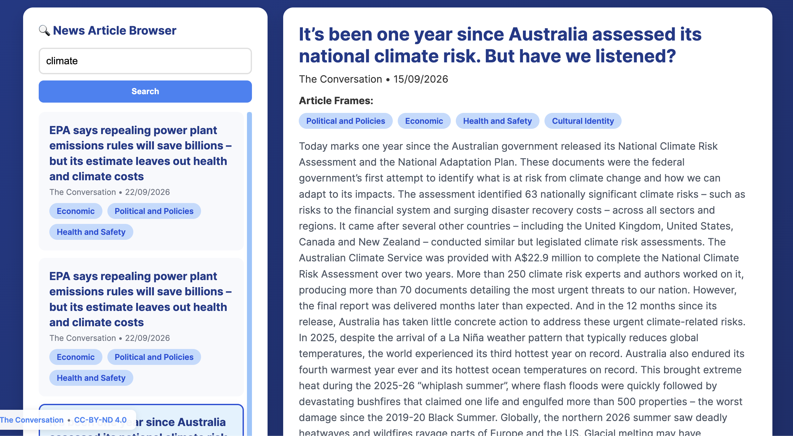
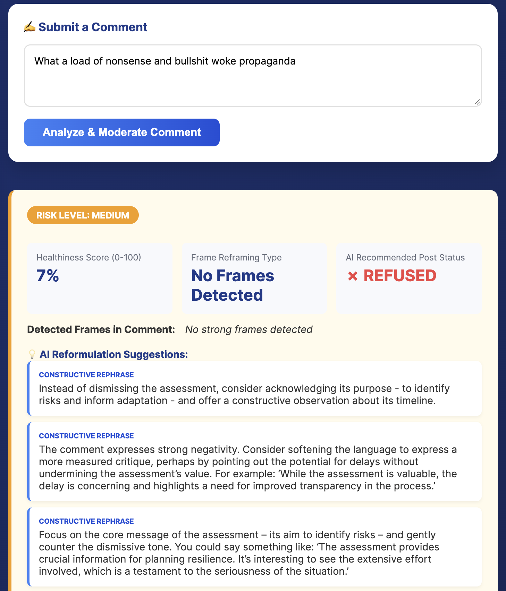

# News Comment Moderator

This system uses a pretrained transformer model to identify the perspectives, or _frames_, used to write a news article. It then invites you to leave a comment on the article.

Two pretrained transformer models assess how your comment relates to the article's perspectives, if at all, and evaluate the quality of the comment. This includes whether it appears healthy, is made in good faith, and contributes to the discussion, or whether it may be unhealthy or harmful.

A large language model brings this information together in real time and provides structured feedback. When a comment may be risky, it also suggests clearer and more constructive ways to express it, based on the context of both the article and the original comment.

Browsing news articles and their detected frames.

Structured feedback and suggested reformulations for a potentially harmful comment.

[Try the News Comment Moderator](https://mpprng--comment-moderation-agent-commentmoderationservice-serve.modal.run) · [View the source code](https://github.com/mattguida/news-comment-moderator)

_The live demo runs on an on-demand service. After a period of inactivity, the site may take up to two minutes to load, and the first comment may take a further two to three minutes to analyse while the models start. Once they are ready, subsequent comments are analysed in real time._
